# HER-OMI study guide

**Is the "HER2-like" group of triple-negative breast cancer really about HER2?**

Hardika Jain · DH607 Introduction to Computational Multi-omics · IIT Bombay · read before the talk on 24 November 2026

<div class="howto" markdown="1">

**How to read this.** Part A tells the whole story in plain words, with no biology assumed. Part B goes through the project in three sections (what and why, how, what we found). Each section first explains the idea and then shows the few lines of code that do it. Part C is for revision: one diagram of the whole pipeline, the story in ten sentences, the numbers to remember, and the questions you are most likely to be asked.

</div>

# Part A. The whole project on one page

Every cell in your body carries the same **DNA**, which works like a recipe book. When a cell needs something, it makes a working copy of one recipe, called **RNA**, and then uses that copy to build a **protein**, which is the thing that actually does a job in the cell. So the flow is always DNA, then RNA, then protein.

One of those recipes is a gene called **ERBB2**. Its protein is called **HER2**, and it sits on the surface of breast cells like an antenna that tells the cell to grow. In about 15 out of 100 breast cancers, the cell has made many extra copies of the ERBB2 gene, so it makes far too much HER2 protein. Doctors call these cancers **HER2-positive**, and they have very good drugs for them. The newest drug, **trastuzumab deruxtecan**, is an antibody that grabs the HER2 protein and carries a poison into the cell.

Another 15 out of 100 breast cancers are **triple-negative (TNBC)**. A pathologist stains them for three proteins (two hormone receptors and HER2) and finds none of the three. These patients have no targeted drug and mostly get chemotherapy, so any new treatment option matters a lot.

In 2026 an Indian research group (**IBCGA**) studied the RNA of Indian TNBC tumours. They found a group whose RNA pattern, measured over 144 genes, looks a little like HER2-positive cancer. They called this group **"HER2-like"** and suggested that these patients might benefit from HER2 drugs.

But a drug that grabs HER2 protein needs HER2 protein to be there. An RNA pattern is only an indirect hint. So my project asks one question at every level of the flow: **is the HER2-like pattern really HER2, at the DNA, at the RNA, and at the protein?** I tested it in two large Western tumour collections (TCGA and METABRIC) plus a protein collection (CPTAC), because the Indian data are not public.

<figure>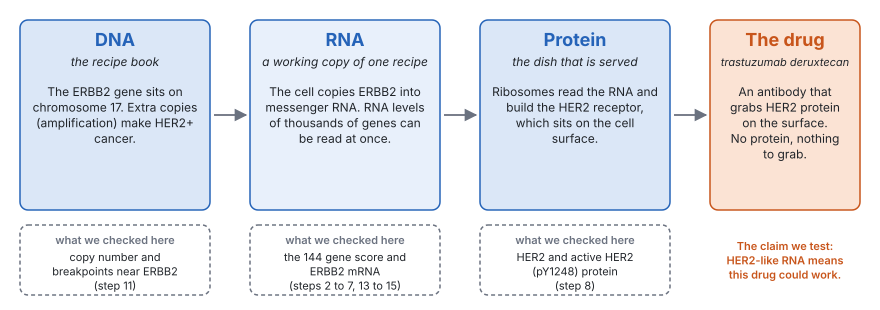<figcaption>The project in one picture. Blue boxes are the three layers of biology; the dashed boxes say what I measured at each layer. The orange box is the drug, which can only act on protein.</figcaption></figure>

**The answer, in one breath.** The pattern is real and it does replicate in Western tumours. But the tumours that score highest are not secretly HER2 tumours. They are a known kind of TNBC driven by a different receptor, the **androgen receptor (AR)**, called **LAR**. At the protein level, HER2-like tumours carry no more HER2 than random chance would give, while AR protein is strongly raised. Their DNA shows no extra ERBB2, and compared with their own normal tissue their ERBB2 does not go up at all. So the name "HER2-like" describes an AR programme, and it should not be used to choose patients for HER2 drugs without testing HER2 protein directly.

<div class="glossary" markdown="1">

**Five words you need for everything else**

- **Gene expression**: how much RNA a cell is making from one gene. "ERBB2 is high" means lots of ERBB2 RNA.
- **Signature**: a list of genes that should go up and genes that should go down in a particular kind of tumour.
- **Score**: one number per tumour that says how strongly that tumour follows the signature.
- **Correlation (rho)**: a number from −1 to +1 for how well two things rise together. 0 means no relation, 0.5 is a clear relation, 0.2 is weak.
- **Cohort**: a collection of patients whose tumours were measured the same way (TCGA, METABRIC, CPTAC).

</div>

<div class="pb"></div>

# Part B1. What we are doing, and why

## B1.1 Three layers, and why the protein layer decides

The figure on the first page is the backbone of the whole project, so it is worth saying it again slowly. DNA is stored information; it does nothing on its own. RNA is the message that the cell is actively using, and it is cheap to measure for twenty thousand genes at once, which is why most cancer studies (including IBCGA) work with RNA. Protein is the working machine, and it is what drugs actually touch.

These layers usually agree, but not always. A cell can make RNA that is never turned into much protein, and the protein level can be controlled after the RNA is made. That gap is the reason this project exists: IBCGA's evidence is at the RNA layer, while their suggestion about treatment depends on the protein layer.

## B1.2 The kinds of breast cancer

<figure>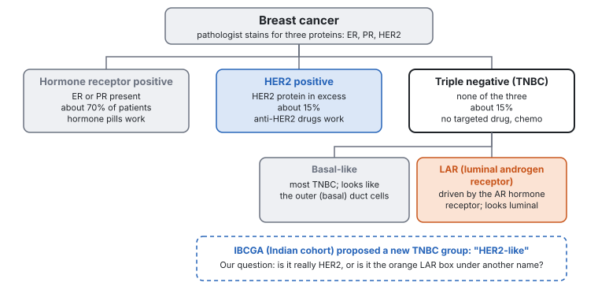<figcaption>How breast cancer is divided in the clinic, and where the HER2-like group would sit. Orange marks the AR-driven LAR type, which turns out to be the key to the whole project.</figcaption></figure>

A pathologist sorts every breast tumour by staining it for three proteins: the estrogen receptor (ER), the progesterone receptor (PR), and HER2. Each answer decides a treatment. Tumours with ER or PR get hormone-blocking pills; tumours with lots of HER2 get anti-HER2 drugs; tumours with none of the three are triple-negative.

TNBC is not one disease. Inside it, researchers using RNA have found several types. Most TNBC are **basal-like**, which means they look like the outer layer of cells in the milk duct. A smaller group, around one in ten, is **LAR (luminal androgen receptor)**. These tumours have lost ER but still run the "luminal" programme of the inner duct cells, driven by the androgen receptor instead of the estrogen receptor. Key LAR genes are **AR, FOXA1** and **INPP4B**.

A related point you may be asked about: some tumours called triple-negative actually have a small amount of ER (1 to 10% of cells stain). These are called **ER-low**, and they behave a lot like LAR tumours. I flagged them separately.

## B1.3 HER2, the drug, and "HER2-low"

<figure>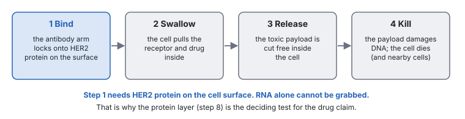<figcaption>How an antibody drug conjugate such as trastuzumab deruxtecan works. Only step 1 depends on the tumour, and it needs HER2 protein.</figcaption></figure>

HER2 is graded by staining on a scale from **0 to 3+**. A score of 3+ (or extra gene copies seen by a DNA test called ISH or FISH) means HER2-positive. Since 2022, tumours that score **1+ or 2+ without extra gene copies** are called **HER2-low**, because trastuzumab deruxtecan works in them too. Many TNBC are HER2-low. This is why IBCGA's suggestion is attractive: if a RNA test could pick out TNBC patients with useful HER2, it would widen access to the drug. It is also why the claim has to be checked at the protein level, because the drug's first step is to bind HER2 protein.

## B1.4 What IBCGA claimed, and the gap we test

<figure>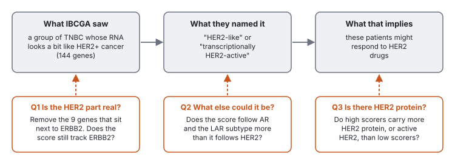<figcaption>The chain of reasoning in IBCGA's paper (grey) and the three questions this project asks of it (orange).</figcaption></figure>

IBCGA compared groups of Indian TNBC tumours and found 144 genes that separate a "HER2-like" group from basal-like TNBC. They supported the name in two ways: nine of the 144 genes sit right next to ERBB2 on chromosome 17 (this stretch of DNA is called the **17q12 amplicon**, and it includes **GRB7**), and the group scored high on pathways labelled as ERBB2 signalling. They then proposed the group as a candidate for HER2 antibody drugs. They never measured HER2 protein.

So the project asks three questions. **First**, if we throw out the nine genes that sit next to ERBB2, does the score still follow ERBB2? If it does not, the "HER2" part of the name was coming only from those neighbours. **Second**, could something else make the score and ERBB2 rise together? The obvious suspect is the AR-driven LAR type. **Third**, and most important for the drug, do high-scoring tumours carry more HER2 protein, or more active HER2?

## B1.5 In the code: getting the data and defining TNBC

All data come from **cBioPortal**, a public website that hosts tumour data in simple tables (one row per gene, one column per tumour). The script `00_download_data.sh` downloads TCGA, METABRIC, CPTAC 2020 and the TCGA normal tissue samples. The IBCGA gene list and pathway tables come from the preprint's supplementary Excel file.

`01_define_tnbc.py` decides which tumours count as TNBC. It follows the clinical rule: ER negative and PR negative by staining, and HER2 negative, where an unclear HER2 stain is settled by the DNA test.

```python
er = t.ER_STATUS_BY_IHC.eq("Negative")
pr = t.PR_STATUS_BY_IHC.eq("Negative")
her2_neg = (ihc.eq("Negative")
            | (ihc.isin(["Equivocal", "Indeterminate"]) & fish.eq("Negative")))
t["TNBC"] = er & pr & her2_neg          # 160 TCGA patients (159 with RNA)
```

METABRIC never stained for PR or HER2, so there the script uses ER staining, PR from RNA, and HER2 from DNA copy number. That gives **250** METABRIC TNBC.

`01b_signature.py` reads the 144 IBCGA genes and checks which ones were measured in both cohorts. **109** are measured in both. Of those, 9 sit on the 17q12 amplicon, which leaves **100 amplicon-free genes (33 up, 67 down)**. These 100 genes are the main signature used for every test that follows. Most of the 35 unmeasured genes are non-coding RNAs that older platforms did not include.

<div class="pb"></div>

# Part B2. How we are doing it

## B2.1 The data, and what each piece can tell us

| Cohort | Tumours used | What was measured | What it answers |
|---|---|---|---|
| TCGA (USA) | 159 TNBC, plus 114 normal breast samples | RNA by sequencing, DNA copy number, protein by antibody array (RPPA) for 131 TNBC | all three layers in the same tumours |
| METABRIC (UK and Canada) | 250 TNBC | RNA by microarray, DNA copy number | an independent replication of every RNA and DNA result |
| CPTAC 2020 | 28 TNBC | protein by mass spectrometry | an independent check of the protein result |
| IBCGA preprint | (data not public) | the 144 genes and their pathway tables | the claim we test |

Two different machines measured the RNA (sequencing in TCGA, microarray in METABRIC). Their raw numbers are not on the same scale, so the method we use has to work on both. That is the reason for the next step.

## B2.2 Turning 100 genes into one number: singscore

<figure>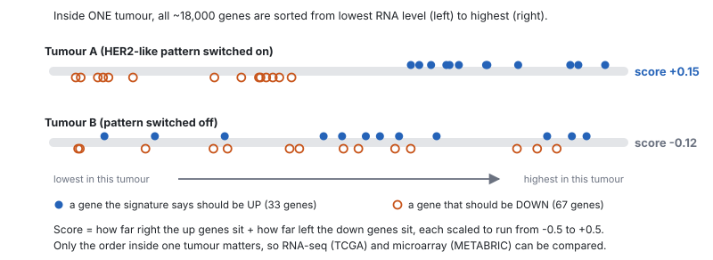<figcaption>How singscore works. Each line is one tumour with its genes sorted by RNA level. When the pattern is switched on, the up genes (blue) crowd to the right and the down genes (orange rings) crowd to the left.</figcaption></figure>

singscore looks at one tumour at a time. It sorts all of that tumour's genes from lowest to highest RNA level and gives each gene a rank. Then it asks two simple questions. Do the signature's up genes sit near the top? Do its down genes sit near the bottom? Each answer is scaled to run from −0.5 to +0.5, and the two are added. A tumour that follows the signature perfectly would score close to +1; a random tumour scores close to 0.

Because only the order of genes inside one tumour matters, the score is not affected by the measuring machine. That is why the same score can be compared across TCGA and METABRIC.

**In the code** (`heromi_lib.py`, used by `02_singscore.py`):

```python
ranks = expr.rank(axis=0)                  # rank every gene inside each tumour
r = ranks.loc[gene_ids]                    # ranks of the signature genes
if reverse: r = N + 1 - r                  # down genes: flip, so low counts as good
lo, hi = (n + 1) / 2, (2 * N - n + 1) / 2  # lowest and highest possible mean rank
return (r.mean() - lo) / (hi - lo) - 0.5   # scale to run from -0.5 to +0.5
```

The total score is the up part plus the down part. `02_singscore.py` makes three versions for every tumour: `full` (109 genes), `no_amp` (the 100 amplicon-free genes, the one used everywhere) and `amp_only` (the 9 amplicon genes alone). Then `02b_annotate.py` attaches, for each tumour, its PAM50 type (basal or not), its ERBB2 and AR RNA levels, and later its TNBCtype subtype (LAR, basal-like 1, and so on).

## B2.3 Why we removed the nine amplicon genes

If a tumour has a few extra copies of the stretch of chromosome 17 around ERBB2, every gene in that stretch goes up together. So a signature that contains GRB7 and its neighbours will "follow ERBB2" automatically, without telling us anything about HER2 biology. Removing those nine genes is the fair test: if the remaining 100 genes still follow ERBB2, there is something more going on.

## B2.4 Is a correlation big enough to matter? The random gene set test

A correlation of 0.3 sounds modest, but is it more than chance? In gene data this is a real problem, because thousands of genes rise and fall together for broad reasons such as how fast the tumour is dividing. Almost any list of 100 genes will correlate a little with almost anything.

So for every test I built a fair comparison. The computer picks **1,000 random sets of genes** with the same size and direction as the signature (33 up and 67 down), never using signature genes, scores every tumour with each random set, and records the correlation each random set reaches. If the real signature beats about 95% of the random sets, the result is meaningful; if it falls inside the range the random sets reach, the result is no better than chance. The random generator always starts from the same seed (607), so the numbers come out identical every time.

```python
rng = np.random.default_rng(seed=607)
for i in range(1000):
    pick = rng.choice(pool, n_up + n_down, replace=False)  # never signature genes
    out[i] = score(pick[:n_up], pick[n_up:])               # same singscore maths
```

This is `random_set_scores` in `heromi_lib.py`. You will see its result as **grey bars** in the slides and in this guide: the grey bar is the range that random gene sets reach.

## B2.5 Taking out a hidden cause: partial correlation

<figure>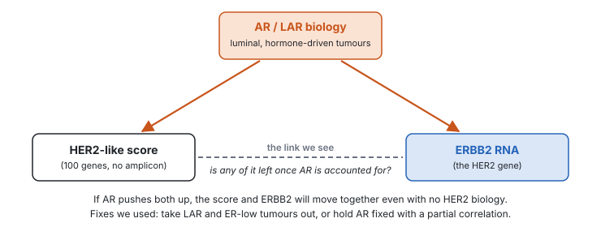<figcaption>The confounding problem. If AR biology raises both the score and ERBB2, the two will move together even when HER2 is not involved.</figcaption></figure>

LAR tumours are known to have slightly higher ERBB2 RNA, and the signature might also pick up LAR genes. If both are true, the score and ERBB2 will correlate for a reason that has nothing to do with HER2 signalling. We deal with this in two ways. The simple way is to **remove** the suspect tumours (LAR and ER-low) and test again. The statistical way is a **partial correlation**: we first remove from both variables the part that AR (or another suspect) can explain, and then correlate what is left.

```python
R = ranks of [x, y, covariates]     # Spearman works on ranks
# strip out of x and y whatever the covariates can explain
res = [R[:, k] - Z @ lstsq(Z, R[:, k]) for k in (0, 1)]
r = np.corrcoef(*res)[0, 1]          # correlate the leftovers
```

This is `partial_spearman` in `heromi_lib.py`. It is also how step 8 asks whether the score tells us anything about HER2 protein **beyond** what ERBB2 RNA already tells us.

## B2.6 The other tools, in one line each

- **Mann-Whitney test**: are the values in group A generally higher than in group B? Used for HER2-low versus HER2 0, for clusters, for groups against normal tissue.
- **Wilcoxon signed-rank test**: the paired version, for a tumour compared with normal tissue **from the same patient** (step 13).
- **AUC**: how well the score separates two groups. 0.5 is a coin toss, 1.0 is perfect. Used for LAR versus other subtypes (step 7).
- **Benjamini-Hochberg correction**: when you run many tests, a few will look significant by luck; this adjusts the p-values for that (steps 8b and 13).
- **Hierarchical clustering (Ward)**: groups tumours by how similar their 100 signature genes look, without telling the computer anything about subtypes (step 15).

## B2.7 Every script, the question it answers, and its main output

| Step | Script | Question in plain words | Main result |
|---|---|---|---|
| 1 | `01_define_tnbc`, `01b_signature` | which tumours and which genes? | 159 TCGA and 250 METABRIC TNBC; 100 genes |
| 2 | `02_singscore`, `02b`, `02c` | give every tumour a score | `scores_tnbc_annot.csv` |
| 3 | `03_basal_only_test` | does the score follow ERBB2, even in basal tumours only? | 0.30 TCGA, 0.48 METABRIC, both above random |
| 4 | `04_her2_ihc_check` | do HER2-low tumours score higher than HER2 0? | slightly, across all TNBC (p 0.03), but not inside basal tumours (p 0.15) |
| 5, 9 | `05_pathway_comparison`, `09_pathway_overlap_check` | do our pathways match IBCGA's, and is their ERBB2 pathway evidence independent? | match 0.70; ERBB2 pathway link drops 0.25 to 0.10 and 0.21 to 0.05 |
| 6 | `06_confounder_test` | inside basal tumours, does cell division, estrogen response or LAR explain the ERBB2 link? | TCGA falls to random level (0.30 to 0.18); METABRIC keeps a modest link (0.48 to 0.40) |
| 7 | `07_tnbctype` | how does the score relate to the LAR subtype? | every LAR tumour is in the top third; AUC 0.97 and 0.96 |
| 8, 8b | `08_protein_test`, `08b_protein_robustness` | do high scorers carry more HER2 protein? | HER2 0.21 and pY1248 0.18, inside random range; AR 0.50 |
| 10 | `10_her2pos_comparison` (and `10b` for METABRIC) | how do HER2-like TNBC compare with real HER2+ cancer? | they share its AR, not its HER2 |
| 11 | `11_dna_layer` | do extra ERBB2 copies explain the link? | 0.47 to 0.43 and 0.55 to 0.55, so no |
| 12 | `12_erlow_sensitivity` | do results hold without ER-low tumours? | yes |
| 13 | `13_normal_comparison` | is ERBB2 higher than in normal breast? | TNBC no (6 of 13 pairs up), HER2+ yes (18 of 24) |
| 14 | `14_normal_admixture` | could normal tissue mixed into samples explain the score? | links unchanged |
| 15 | `15_cluster_heatmap` | what does an unsupervised grouping find? | a 21-tumour cluster that is mostly LAR |

<div class="pb"></div>

# Part B3. What we found

Each finding below has the same shape: what we asked, what we saw, and what it means.

## Finding 1. The signal is real in Western tumours (steps 3 and 5)

Across all TNBC, the amplicon-free score correlates with ERBB2 RNA at **0.47 in TCGA and 0.55 in METABRIC**, while random gene sets reach only about 0.22. A sceptic would say that a few luminal tumours with high score and high ERBB2 create this alone, so I repeated it **inside basal tumours only**. The link becomes weaker but survives: **0.30 in TCGA and 0.48 in METABRIC**, against random ranges of 0.22 and 0.20. The pathways that move with the score also match IBCGA's own table (correlation 0.70). So we are not dismissing IBCGA's observation. The pattern exists. The question is what it is.

**In the code**, `03_basal_only_test.py` filters to basal tumours, scores them, and compares the real correlation with 1,000 random ones:

```python
if subset == "Basal only":
    g = g[g.pam50.eq("Basal")]
obs = singscore(expr, up, down).total
rho = spearman(obs, erbb2)                       # the real signature
null = [spearman(fast(up_i, down_i), erbb2)      # 1,000 random sets
        for each random pick]
empirical_p = (sum(abs(null) >= abs(rho)) + 1) / 1001
```

## Finding 2. The top of the score is the LAR subtype (steps 6, 7, 12, 15)

When tumours are split into thirds by score, **all 13 LAR tumours in TCGA and all 26 in METABRIC land in the top third**. The score separates LAR from other TNBC types almost perfectly (AUC **0.97 and 0.96**). When LAR and ER-low tumours are removed, the ERBB2 link drops to **0.34 and 0.45**, so they carry a large part of it. To be fair to IBCGA, a modest RNA link does remain inside basal tumours in METABRIC even after accounting for cell division and estrogen response (0.48 to 0.40, step 6), although in TCGA it falls to the random level (0.30 to 0.18). Whatever that leftover RNA link is, the next finding shows it does not reach the protein.

The clustering in step 15 shows the same thing without being told about subtypes. The computer groups the 159 TCGA tumours by their 100 signature genes and finds a small cluster of **21 tumours**, of which **10 are LAR and 6 are ER-low, with only 1 basal**. That cluster has the high score (median 0.08) and very high AR RNA (9.2 against 3.6). The other 138 tumours, 115 of them basal, score low (median −0.11).

<figure>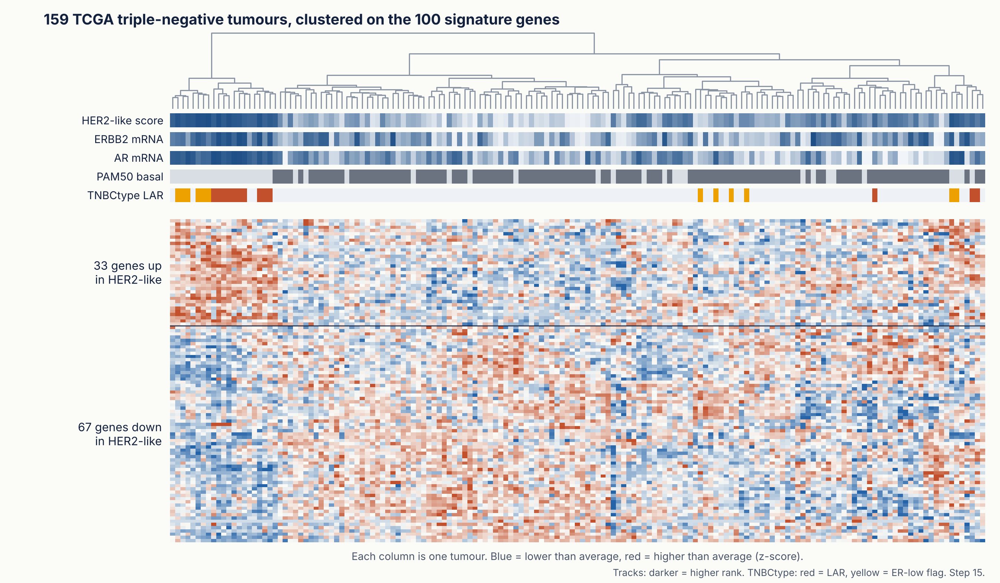<figcaption>Step 15. Rows are the 100 signature genes, columns are 159 TCGA TNBC grouped by similarity. The coloured tracks on top show score, ERBB2, AR, basal type and LAR or ER-low. The small cluster on the left is where the high scores, AR and LAR all sit.</figcaption></figure>

**In the code**, `07_tnbctype.py` cuts the score into thirds and counts subtypes, and computes the AUC directly from the Mann-Whitney statistic:

```python
a["tertile"] = pd.qcut(a.score_no_amp, 3, labels=["low", "mid", "high"])
auc = mannwhitneyu(score[lar], score[~lar]).statistic / (n_lar * n_other)
```

## Finding 3. There is no extra HER2 protein (step 8)

This is the deciding test for the drug claim. TCGA measured about 200 proteins with an antibody array (**RPPA**) in 131 of our TNBC. The score correlates with total HER2 at **0.21** and with active HER2 (phosphorylated at position 1248, written **pY1248**) at **0.18**. Both sit **inside the range that random gene sets reach** (up to about 0.24). By contrast the luminal control proteins **AR (0.50)** and **INPP4B (0.55)** are far outside it. And once ERBB2 RNA is accounted for, the score adds nothing about HER2 protein (partial correlation close to 0). In the independent CPTAC proteome the score again follows AR strongly (0.75).

<figure>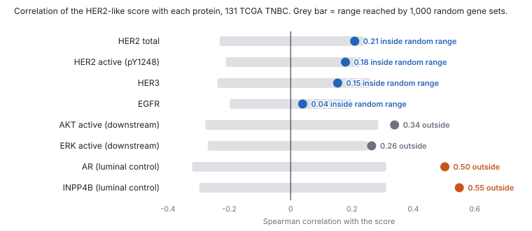<figcaption>Step 8, real results. Each dot is the correlation of the score with one protein; the grey bar is what random gene sets reach. HER2 family proteins (blue) stay inside the grey bars. The luminal AR proteins (orange) are far outside.</figcaption></figure>

A doctor might ask the question in a different way: how much HER2 do the high scorers have, on the same scale as real HER2-positive cancer?

<figure>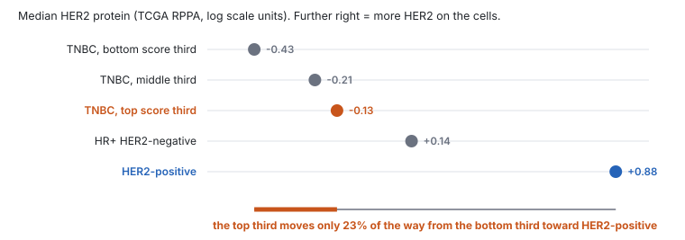<figcaption>HER2 protein in each group. The top score third (orange) moves only about a quarter of the way toward HER2-positive cancer, and it stays below ordinary hormone-positive HER2-negative tumours.</figcaption></figure>

The most clinical version of the question is about the **61 HER2-low TNBC**, who are exactly the patients who could receive trastuzumab deruxtecan. Among them, the score's correlation with HER2 protein is **−0.02** (nothing), while its correlation with AR protein is **0.68**. In the group where the treatment decision is actually made, the score sorts patients by AR.

**In the code**, `08_protein_test.py` loops over each protein and records three things: the real correlation, the random range, and the partial correlation given ERBB2 RNA:

```python
r = spearmanr(g.score_no_amp, g[protein])[0]
null = [spearmanr(random_score_i, g[protein])[0] for i in 1000 sets]
pr, _ = partial_spearman(g.score_no_amp, g[protein], [g.ERBB2_log2])
rows.append(dict(protein=lab, rho_score=r, null_lo=quantile(null, .025),
                 null_hi=quantile(null, .975), partial_score_given_mRNA=pr))
```

For the ruler figure it cuts the TNBC into score thirds and computes how much of the gap the top third closes: `(top - bottom) / (HER2pos - bottom)`, which is 0.23.

## Finding 4. Next to real HER2-positive cancer, they share AR, not HER2 (steps 9 and 10)

My professor suggested comparing the HER2-like tumours directly with true HER2-positive cancer. Step 10 puts three TCGA groups side by side: HER2-positive tumours that are also ER and PR negative (so they differ from TNBC only in HER2), the top third of TNBC (HER2-like), and the bottom third (basal-like). On every HER2 measure, from gene copies to RNA to protein, HER2-like tumours sit with basal TNBC: HER2 protein **−0.09 against 2.38**. On AR and FOXA1 they sit with HER2-positive cancer: AR protein **0.51 against 0.49**. This makes sense, because hormone-negative HER2-positive tumours are often AR-high, so a signature built by comparing tumour groups can pick up the shared AR programme instead of HER2.

<figure>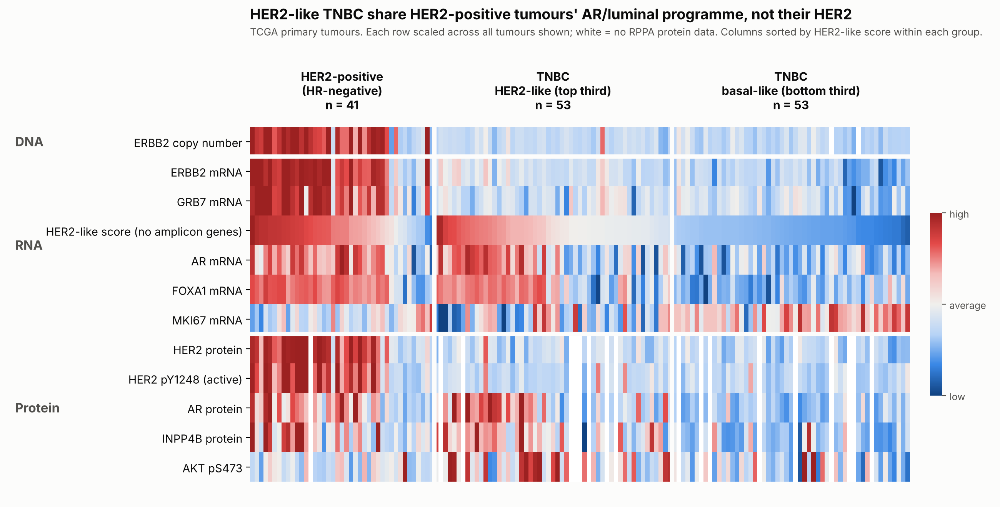<figcaption>Step 10. Rows are measurements grouped by layer (DNA, RNA, protein); red is high and blue is low. Read along the HER2 rows and then along the AR rows.</figcaption></figure>

Step 9 also re-checks IBCGA's own pathway evidence. Their strongest "ERBB2 signalling" pathway (Reactome "GRB7 events in ERBB2 signalling") has only four or five measured genes, and two of them, ERBB2 and GRB7, are also signature genes. Take those two out and the pathway's link to the score falls from **0.25 to 0.10** in TCGA and **0.21 to 0.05** in METABRIC. The evidence was largely circular.

## Finding 5. DNA and normal tissue agree (steps 11, 13, 14)

**DNA.** Extra copies of ERBB2 do not explain the RNA link: accounting for copy number moves it from **0.47 to 0.43** in TCGA and leaves it at **0.55** in METABRIC. One lead for later: **9 of 155** TCGA tumours have a DNA break near ERBB2 (close to the IKZF3 gene that IBCGA highlighted). Those few do have more ERBB2, but nine is far too few to conclude anything.

**Normal tissue.** Step 13 answers my professor's other request. TCGA also sequenced normal breast tissue from 114 patients, and some of those patients are in our tumour groups, so we can compare a tumour with that same person's normal tissue.

<figure>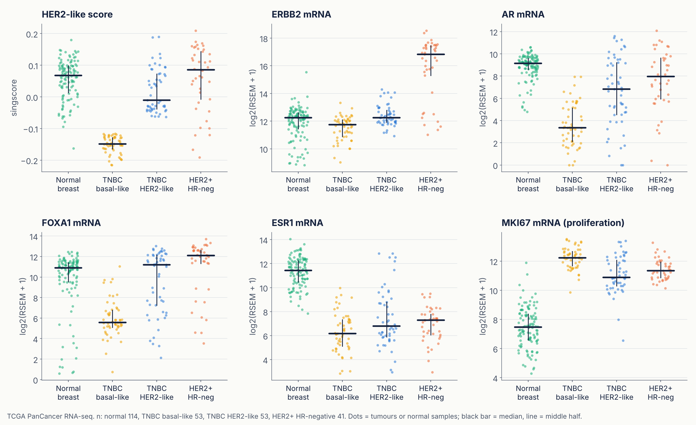<figcaption>Step 13, groups. ERBB2 RNA is 12.24 in normal breast, 11.74 in basal-like TNBC, 12.24 in HER2-like TNBC and 16.83 in HER2-positive cancer. HER2-like TNBC sit exactly at the normal level.</figcaption></figure>

<figure>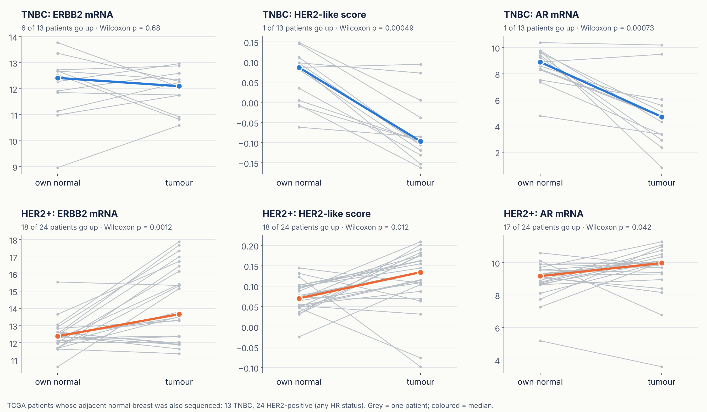<figcaption>Step 13, matched pairs. Each line joins one patient's normal tissue to their tumour. In TNBC, ERBB2 goes up in only 6 of 13 patients (no real change, p = 0.68). In HER2-positive cancer it goes up in 18 of 24 (p = 0.001).</figcaption></figure>

Interestingly, normal breast itself scores fairly high on the signature (0.07, higher than basal TNBC at −0.15), because normal breast contains many luminal cells. Step 14 checks whether normal tissue mixed into tumour samples could create the results, using fat-cell genes as a marker of how much normal tissue is present. Accounting for it leaves every link unchanged.

**In the code**, the paired test in `13_normal_comparison.py` keeps only patients with both samples and uses the Wilcoxon signed-rank test:

```python
d = T[f] - N[f]                 # tumour minus own normal, per patient
rows.append(dict(median_change=d.median(), n_up=int((d > 0).sum()),
                 p_wilcoxon=stats.wilcoxon(T[f], N[f]).pvalue))
```

## The verdict

<figure>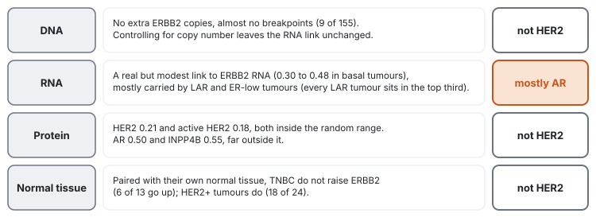<figcaption>All four layers point the same way.</figcaption></figure>

The HER2-like pattern replicates, so IBCGA saw something real. But at every layer where HER2 itself can be measured, the HER2-like tumours look like ordinary TNBC, while their AR is strongly raised. The best description of this group is an **AR or luminal programme**, mostly the known LAR subtype, and not an active HER2 state. For patients, this means the RNA score should not be used to pick people for HER2 drugs; HER2 should still be judged by staining the protein.

**Limitations to state honestly.** I could only test Western tumours, because IBCGA's Indian data are not public, so the protein question is still untested in Indian patients. 35 of the 144 genes could not be measured (mostly non-coding). CPTAC has only 28 TNBC. Everything here is a correlation, not a test of drug response.

**Future scope.** Stain HER2 and AR in IBCGA's own tumours; score tumours from HER2-low drug trials that recorded response; test whether the score finds patients who respond to AR blockers; repeat in Korean and Chinese cohorts; check the DNA breaks with whole-genome data; use single-cell data to separate tumour cells from normal luminal cells.

<div class="pb"></div>

# Part C. Revision

## C1. The whole pipeline in one picture

<figure>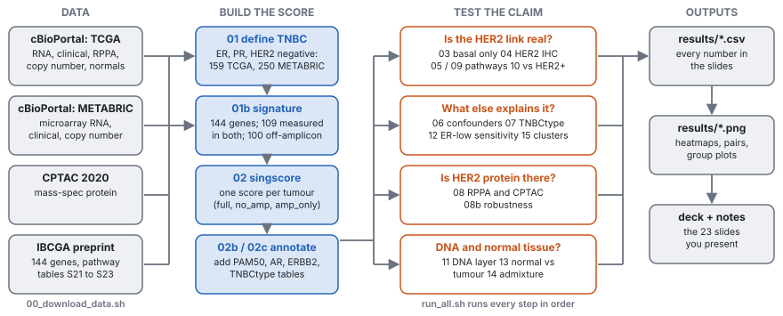<figcaption>Data flows left to right. Blue steps build the score once; orange boxes are the four questions, each answered by its own scripts; every number and figure in the slides comes from the results folder. `run_all.sh` runs everything in order.</figcaption></figure>

## C2. The story in ten sentences

1. Breast cancers are sorted by three proteins; TNBC has none of them and has no targeted drug.
2. HER2-positive cancer has extra ERBB2 genes and too much HER2 protein, and HER2 drugs grab that protein.
3. IBCGA found a 144-gene RNA pattern in Indian TNBC and called it "HER2-like", suggesting HER2 drugs.
4. Drugs need protein, so I tested the claim at the DNA, RNA and protein layers in TCGA, METABRIC and CPTAC.
5. I scored every tumour with singscore, using the 100 genes not sitting next to ERBB2, and compared every result with 1,000 random gene sets.
6. The pattern replicates and follows ERBB2 RNA a little, even in basal tumours.
7. But the highest scorers are the AR-driven LAR subtype: every LAR tumour is in the top third.
8. At the protein level, HER2 and active HER2 are no better than random, while AR is strongly linked.
9. Next to real HER2-positive cancer, HER2-like tumours share AR, not HER2, and their ERBB2 is no higher than in normal breast.
10. So "HER2-like" is an AR programme, and HER2 should still be judged by protein staining.

## C3. Numbers to remember

| What | TCGA | METABRIC |
|---|---|---|
| TNBC tumours | 159 | 250 |
| Signature genes used | 100 (33 up, 67 down) | same |
| Score vs ERBB2, all TNBC (random reaches) | 0.47 (0.23) | 0.55 (0.22) |
| Score vs ERBB2, basal only (random reaches) | 0.30 (0.22) | 0.48 (0.20) |
| Same, without LAR and ER-low | 0.34 | 0.45 |
| LAR tumours in top third; AUC | 13 of 13; 0.97 | 26 of 26; 0.96 |
| ERBB2 pathway link, before and after removing shared genes | 0.25 to 0.10 | 0.21 to 0.05 |
| Score vs ERBB2 after accounting for copy number | 0.47 to 0.43 | 0.55 to 0.55 |

| Protein (TCGA RPPA, 131 TNBC) | Value |
|---|---|
| HER2 total; active HER2 pY1248 | 0.21; 0.18 (random range reaches about 0.24) |
| AR; INPP4B; AKT pS473 | 0.50; 0.55; 0.34 |
| CPTAC AR (28 TNBC) | 0.75 |
| HER2-low TNBC (61): score vs HER2; vs AR | −0.02; 0.68 |
| Gap to HER2-positive closed by top third | 23% |
| HER2 protein: HER2-like vs HER2-positive | −0.09 vs 2.38 |
| AR protein: HER2-like vs HER2-positive | 0.51 vs 0.49 |

| Normal tissue (step 13) | Value |
|---|---|
| ERBB2 RNA: normal, basal-like, HER2-like, HER2+ | 12.24, 11.74, 12.24, 16.83 |
| Score: normal, basal-like, HER2-like, HER2+ | 0.07, −0.15, −0.01, 0.09 |
| Pairs with ERBB2 up: TNBC; HER2+ | 6 of 13 (p 0.68); 18 of 24 (p 0.001) |
| Cluster (step 15): small cluster | 21 tumours, 10 LAR, 6 ER-low, 1 basal |

## C4. Questions you are likely to get, with short answers

**Why not just use IBCGA's Indian data?** It is not publicly available. That is the main limitation, and the first item of future work is to stain protein in their own tumours.

**Why singscore and not a simpler average?** TCGA and METABRIC were measured on different machines, so their raw numbers are not comparable. singscore uses only the order of genes inside each tumour, so it works on both.

**Why remove the nine amplicon genes?** They sit right next to ERBB2 on the chromosome, so they rise with it automatically. Keeping them would make the score follow ERBB2 by construction.

**Why compare against random gene sets?** In RNA data, almost any gene list correlates a little with almost anything, because large programmes such as cell division move thousands of genes together. The random sets show how big a correlation chance alone produces.

**Isn't 0.21 for HER2 protein still positive?** It is, but random gene sets of the same size reach up to about 0.24, so 0.21 is what any gene list would give. AR at 0.50 is far beyond that range.

**Could the AR link just be normal tissue in the sample?** Step 14 accounts for normal tissue using fat-cell genes, and the links do not change. Single-cell data would settle it fully, which is in future work.

**So is there no HER2 signal at all?** At the RNA level there is a small leftover link to ERBB2 inside basal tumours in METABRIC, even after accounting for cell division and estrogen response. But it does not show up as HER2 protein or active HER2, which is what a drug needs.

**Why not do survival analysis?** Without knowing which patients got HER2 drugs, survival cannot tell us whether those drugs would work, so it would not answer the question.

**Why not cluster everything first?** Step 15 does cluster, and it mainly rediscovers the LAR subtype, which supports the main finding rather than adding a new one.

**What is new compared with IBCGA?** Testing the signature outside India, against random gene sets, at the protein layer (including HER2-low tumours), against true HER2-positive cancer, and against normal breast. I found no published study that did any of these.
